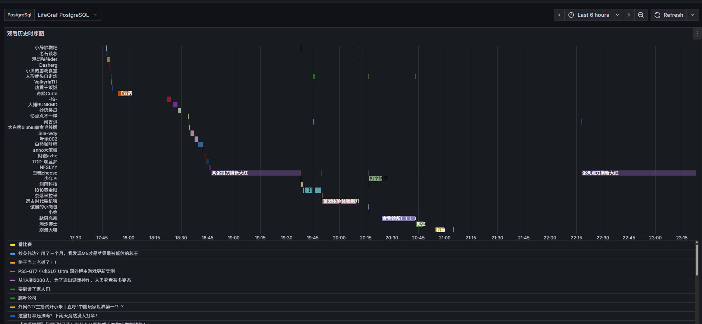
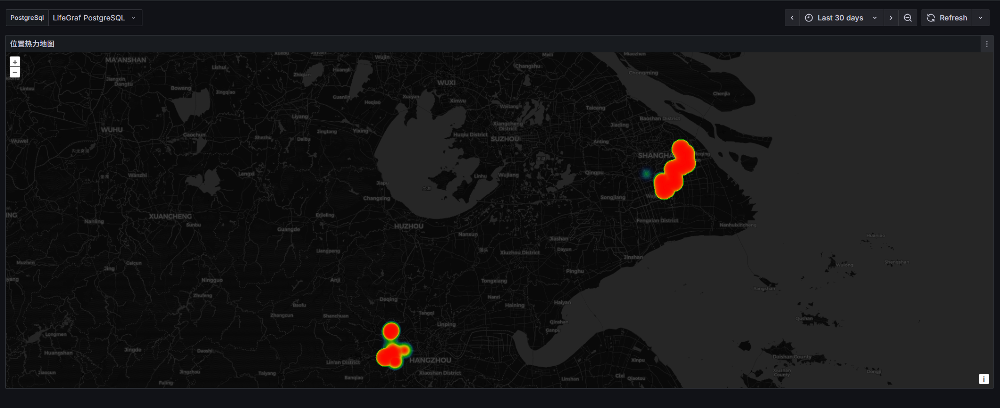
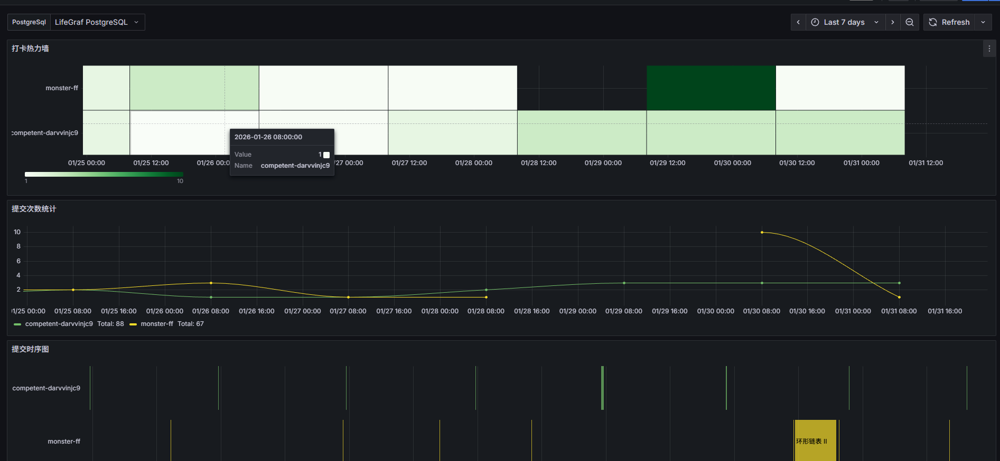
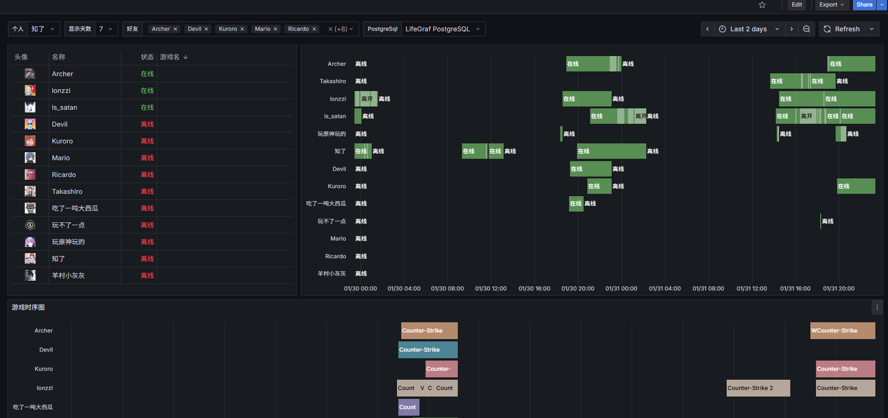
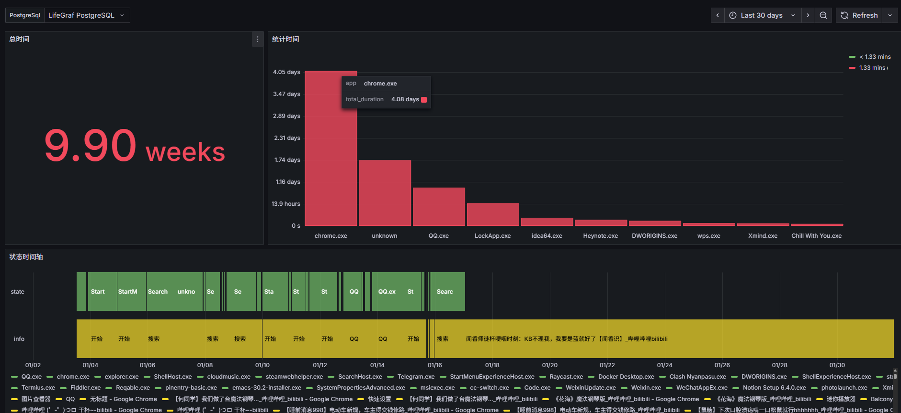

# LifeGraf - Personal Data Aggregation Platform

LifeGraf 是一个个人数据聚合平台，旨在从多个来源（如Bilibili、Steam、ActivityWatch、GPS位置等）收集和存储活动数据，并通过Grafana进行可视化展示。

## 功能特性

- **多数据源集成**：支持从多种平台和服务收集数据
  - Bilibili 观看记录
  - Steam 游戏活动
  - ActivityWatch 桌面活动追踪
  - GPS 位置数据
  - LeetCode 提交记录

- **自动化同步**：定时同步任务自动获取最新数据
- **时间序列数据库**：使用 PostgreSQL + TimescaleDB 存储时序数据
- **Grafana 可视化**：提供丰富的数据可视化仪表板
- **可扩展架构**：模块化设计便于添加新的数据源

## 数据可视化

LifeGraf 预配置了多个Grafana仪表板：

- **BiliBili观看记录**：展示您的B站观看历史和趋势
- **GPS信息**：显示您的地理位置轨迹,通过GPSLogger上报
- **LeetCode时序图**：跟踪您的刷题进度
- **Steam好友状态**：监控Steam好友的游戏活动
- **电脑使用监控**：记录您的电脑使用情况

<!-- 截图占位符 -->






## 技术栈

- **后端框架**: Spring Boot 3.5.8
- **编程语言**: Java 21
- **数据库**: PostgreSQL with TimescaleDB
- **ORM**: MyBatis-Plus
- **API文档**: Knife4j (OpenAPI 3)
- **数据库迁移**: Flyway
- **前端模板**: Freemarker
- **依赖注入**: Lombok & MapStruct
- **可视化**: Grafana

## 系统架构

```
lifegraf-parent/                    # Maven父项目
├── lifegraf-common/                # 公共模块（共享配置、工具）
├── lifegraf-collector/             # 数据收集模块（Spring Modulith）
│   ├── lifegraf-bilibili/          # Bilibili视频平台
│   ├── lifegraf-steam/             # Steam游戏平台
│   ├── lifegraf-activitywatch/     # ActivityWatch桌面追踪
│   ├── lifegraf-electricity/       # 电费使用情况
│   ├── lifegraf-gps/               # GPS位置追踪
│   └── lifegraf-leetcode/          # LeetCode提交记录
└── lifegraf-boot/                  # 主应用启动器
    └── src/main/resources/
        ├── db/migration/           # Flyway迁移脚本
        ├── mapper/                 # MyBatis XML映射器
        └── templates/              # Freemarker模板
```

## 快速开始

### 前提条件

- Java 21
- Maven 3.6+
- Docker & Docker Compose
- PostgreSQL (或使用提供的Docker Compose配置)

### 本地运行

1. 克隆项目：
   ```bash
   git clone <repository-url>
   cd LifeGraf
   ```

2. 启动服务（包含PostgreSQL和Grafana）：
   ```bash
   docker-compose up -d
   ```

3. 构建并运行应用：
   ```bash
   ./mvnw clean package -DskipTests
   ./mvnw spring-boot:run -pl lifegraf-boot
   ```

4. 访问应用：
   - 应用程序：http://localhost:8080
   - API文档：http://localhost:8080/doc.html
   - Grafana：http://localhost:3000

### Docker 部署

1. 构建并启动所有服务：
   ```bash
   docker-compose up -d --build
   ```

## 配置

### 环境变量

创建 `.env` 文件来自定义配置：

```env
# GRAFANA管理员密码
GRAFANA_PASSWORD=your_secure_password

# 模块启用/禁用
STEAM_ENABLED=true
ELECTRICITY_ENABLED=true
BILIBILI_ENABLED=true
GPS_ENABLED=true
ACTIVITY_WATCH_ENABLED=true
LEETCODE_ENABLED=true

# Steam 配置
STEAM_API_KEY=your_steam_api_key
STEAM_MY_ID=your_steam_id

# 电费配置
ELECTRICITY_ID=your_electricity_id
ELECTRICITY_USERNAME=your_username

# LeetCode 配置
LEETCODE_USER_SLUG=your_username
```

### 模块配置

每个模块都有自己的配置前缀：

```yaml
app:
  steam:
    base-url: ${STEAM_BASE_URL:steamapi.kiroe.cn}
    api-key: ${STEAM_API_KEY:...}
    my-steam-id: ${MY_STEAM_ID:...}
    cron: ${STEAM_CRON:0 0/5 * * * ?}  # 每5分钟执行一次
  electricity:
    base-url: ${ELECTRICITY_BASE_URL:...}
    cron: ${ELECTRICITY_CRON:0 0/10 * * ?}  # 每10分钟执行一次
  activity-watch:
    base-url: ${ACTIVITY_WATCH_BASE_URL:...}
    cron: ${ACTIVITY_WATCH_CRON:0 0/10 * * * ?}  # 每10分钟执行一次
  bilibili:
    cron: ${BILIBILI_CRON:0 0/10 * * * ?}  # 每10分钟执行一次
  leetcode:
    base-url: ${LEETCODE_BASE_URL:...}
    user-slug: ${LEETCODE_USER_SLUG:...}
```

## 开发指南

### 添加新数据源

要添加新的数据源，请遵循以下模式：

1. 在 `lifegraf-collector` 下创建新模块
2. 创建配置属性类（`*Properties`）
3. 实现数据收集逻辑
4. 创建数据库实体和映射器
5. 使用 MapStruct 进行对象转换
6. 创建定时任务同步数据

### 模块结构

每个收集器模块遵循相同的结构：

```
cn.kiroe.lifegraf.<module>/
├── config/              # 配置属性类，使用 @ConfigurationPropertiesScan
├── controller/          # REST端点和视图控制器
├── service/             # 业务逻辑（接口+实现）
├── mapper/              # MyBatis-Plus映射器（继承 BaseMapper）
├── model/               # 数据库实体
├── converter/           # MapStruct DTO到实体映射器
├── remote/              # 外部API客户端
│   ├── *ClientConfig    # WebClient配置
│   ├── *Client/*ApiClient # HTTP服务接口，使用 @HttpExchange
│   └── dto/             # API响应DTO
├── scheduler/           # @Scheduled 定时任务用于数据同步
└── enums/               # 枚举
```

## 贡献

欢迎贡献代码！请遵循以下步骤：

1. Fork 项目
2. 创建功能分支 (`git checkout -b feature/AmazingFeature`)
3. 提交更改 (`git commit -m 'Add some AmazingFeature'`)
4. 推送到分支 (`git push origin feature/AmazingFeature`)
5. 打开 Pull Request

## 许可证

该项目采用 MIT 许可证 - 详见 [LICENSE](LICENSE) 文件。

## 支持

如果您遇到任何问题或有建议，请提交 Issue 或 Pull Request。